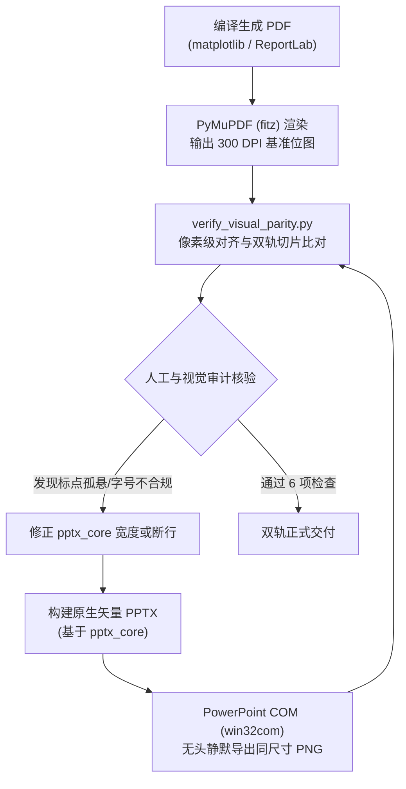

# 双轨视觉一致性（Visual Parity）保障协议与质检标准

## 一、双轨一致性的定义与意义

在科研制图中，“双轨交付”（Dual-Track Delivery）指同时输出：
1. **印刷/出版级矢量 PDF**（由 matplotlib 或 ReportLab 直接生成，保障绝对的几何精确度与出版质量）；
2. **完全可编辑 PPTX**（由 python-pptx 生成全原生形状与文本，方便用户、导师或合作者自由双击修改文案与微调布局）。

**核心挑战**：
若 PPTX 与 PDF 仅“大致相似”，在文字换行、圆角曲率、阴影、中文字体、图注对齐上存在肉眼可见的差异，用户在 PPTX 里微调后再次导出就会导致版式完全走样。

**目标：实现 100% 像素级对齐（Pixel-Perfect Parity）！**

---

## 二、四大视觉差异根源与消除对策

| 差异维度 | 常见失真现象 | 根治对策 | 共享底层工具 |
|---|---|---|---|
| **中文字体** | PDF 为思源宋体，PPTX 在 Office 打开变成默认宋体或微软雅黑 | 必须注入 OpenXML `<a:ea typeface="..."/>` 标签 | `pptx_core.apply_east_asian_font` |
| **圆角弧度** | PDF 为精致克制的 3mm 微圆角，PPTX 默认呈巨大椭圆弧度 | 注入 `avLst` 将 `adj` 参数压缩至 2500–3500 | `pptx_core.set_round_radius` |
| **投影质感** | PDF 干净扁平，PPTX 默认带模糊的灰色投影，边缘脏污 | 移除形状 XML 中的 `<a:effectLst>` 节点 | `pptx_core.remove_shadow` |
| **标点折行** | PDF 逗号稳稳留在行末，PPTX 中逗号掉到下一行行首（孤悬） | 清零文本框内边距 + 精确字符宽度预算 + 意群主动断行 | `pptx_core.configure_text_frame` & `sanitize_cjk_line_breaks` |
| **连线文字** | PDF 标注清晰水平，PPTX 标注随箭头倾斜或与连线打架 | 强制采用 0 度水平文字呼叫气泡，带纯白遮罩 | `pptx_core.create_horizontal_callout` |

---

## 三、闭环自动化质检流程（Inspection Protocol）

所有图表和海报在交付前，必须执行闭环自检：

### 终极交付 6 项审计核对单：
1. **0 度水平文字**：斜向连线上的说明文字是否绝对水平，有无扭曲或倒置；
2. **文字防穿帮遮罩**：文字与底层连线是否有纯白遮罩隔离，绝无穿线干扰；
3. **标点避头尾**：逐行检视文本块，没有任何行首出现孤立的 `，`、`。`、`；`、`、`；
4. **字体真实渲染**：在宿主机 Office 中打开 PPTX，确认 East Asian 字体正常载入，无缺失弹窗；
5. **卡片圆角与扁平度**：卡片弧度优雅克制（3000），没有模糊毛刺阴影；
6. **图文数据完全一致**：两套交付物上的数字量纲、文本措辞与图号必须 100% 对应。
